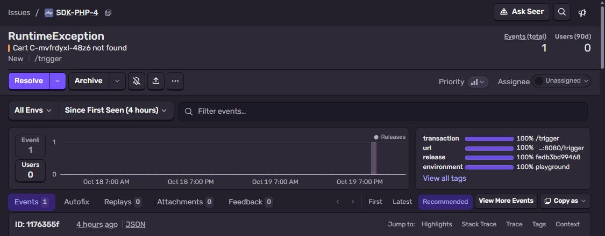
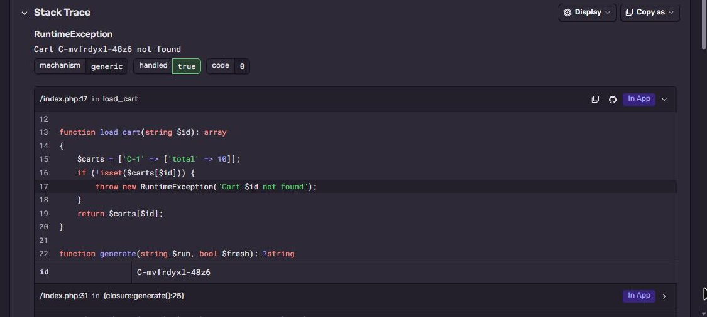

# Sentry + PHP

Plain PHP, no framework. One `index.php` and `sentry/sentry` from Composer.
Part of [Sentry Playground](https://github.com/fsmaster/sentry-playground).



## What you need

- PHP 8.2+ with `curl` and `json` extensions (both are on by default)
- [Composer](https://getcomposer.org/download/)
- Sentry project with platform **PHP**

## 1. Get the DSN

Sentry → **Settings → Projects → (project) → Client Keys (DSN)**.

## 2. Run it

```bash
git clone https://github.com/fsmaster/sentry-sample-php.git
cd sentry-sample-php
composer install
export SENTRY_DSN="https://<key>@<org>.ingest.us.sentry.io/<project-id>"
php index.php
```

Prints `event id: ...`. Same file works as web app:

```bash
php -S localhost:8080 index.php
curl -X POST localhost:8080/trigger -d '{"run":"test-1"}'
```

No Composer and no PHP locally? Docker:

```bash
docker build -t sentry-sample-php .
docker run --rm -p 8080:8080 -e SENTRY_DSN="..." sentry-sample-php
```

## 3. Check it in Sentry

**Issues** → `RuntimeException: Cart C-... not found`. Stack trace goes `generate()` → `load_cart()` and
shows the PHP source around the `throw`:



## How it works

```php
\Sentry\init([
    'dsn' => getenv('SENTRY_DSN'),
    'environment' => 'local',
    'send_default_pii' => false,
]);
```

That's enough for uncaught exceptions and fatal errors, SDK registers its own error and exception
handlers. For caught exceptions call `\Sentry\captureException($e)`. In case if you use Laravel or Symfony, there are separate packages (`sentry/sentry-laravel`, `sentry/sentry-symfony`), init is almost the same. Source code in the stack trace is
read by the SDK on the server (PHP files are there anyway), nothing to upload.

`\Sentry\withScope()` in the sample adds `run_id` tag and fingerprint only for this one event.

Request body can have `"dsn"`, the playground sends it for **Use my DSN**. Every PHP request is a fresh run, so
it is just `\Sentry\init` with that DSN for this request.

## Troubleshooting

| Symptom | Why |
|---|---|
| `event id:` is empty | DSN not set, SDK does nothing without it. |
| Works in CLI, not under php-fpm | env vars from your shell are not passed to fpm. Put DSN in fpm pool config (`env[SENTRY_DSN]=...`) or your framework config. |
| `cURL error 60` | PHP can't verify TLS. Update `ca-certificates` or set `curl.cainfo` in php.ini. |
